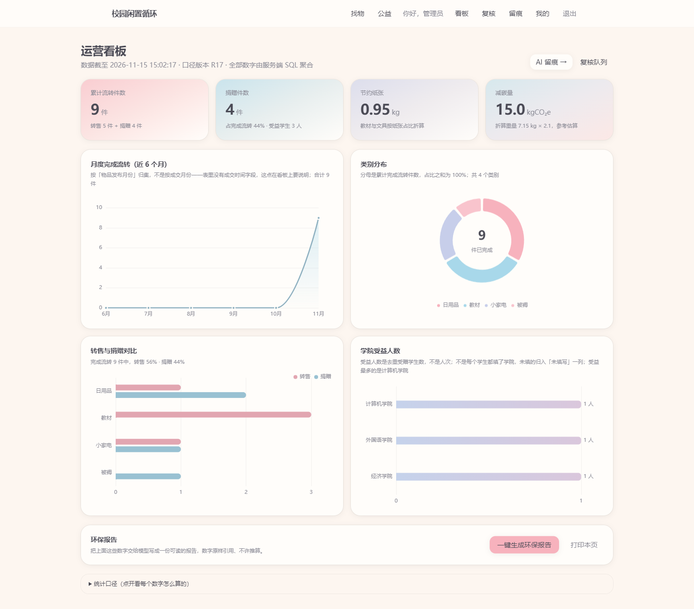
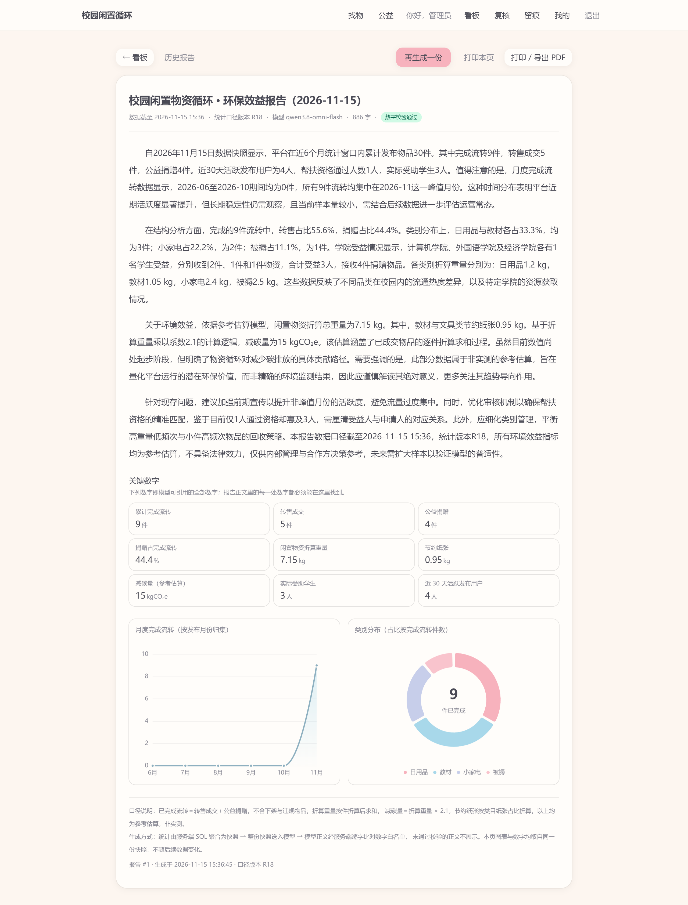
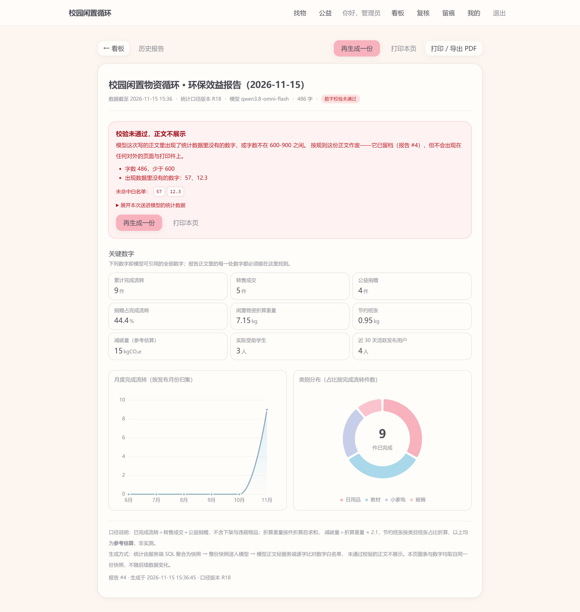
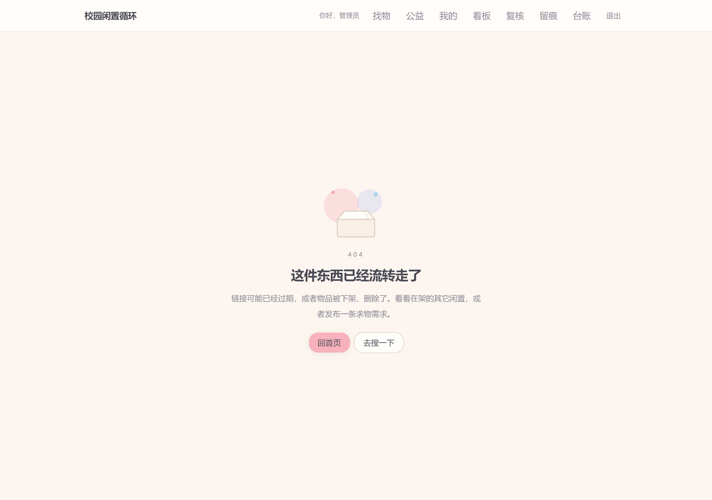
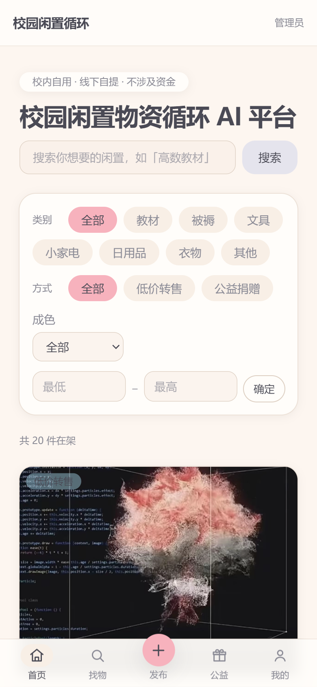

# 校园闲置物资循环 AI 平台

面向本校学生的公益向闲置流转 Web 应用：毕业季教材、被褥、文具、小家电在校内循环，支持**低价转售**与**公益捐赠给困难新生**双通道。AI 负责发布提效（识图 + 文案 + 估价）、供需语义匹配、违规审核与感谢信生成，后台提供环保数据看板。

技术栈：Next.js 15 (App Router) + TypeScript + Tailwind CSS + SQLite (better-sqlite3) + 阿里百炼 DashScope（qwen-vl-max / qwen-plus / text-embedding-v3）+ ECharts。

## 文档索引

| 文件 | 内容 |
|---|---|
| [docs/01-PRD.md](docs/01-PRD.md) | 需求、痛点、功能清单、非功能要求、验收标准、里程碑 |
| [docs/02-页面流程.md](docs/02-页面流程.md) | 站点地图、三条用户旅程、页面结构与视觉规范 |
| [docs/03-数据库设计.md](docs/03-数据库设计.md) | ER 关系、9 张表字段、状态机、环保折算系数 |
| [docs/04-AI接口契约.md](docs/04-AI接口契约.md) | 5 个 AI 接口的输入输出、降级策略、Prompt 设计要点 |
| [docs/05-安全复查.md](docs/05-安全复查.md) | R20 全仓安全复查：越权、SQL、上传、穿越、Cookie、错误泄漏、AI 限流的问题清单与改法 |
| [docs/ai-prompt-history.md](docs/ai-prompt-history.md) | **Prompt 历史快照**（脚本生成）：按功能分组的调用次数 / 成功率 / 平均耗时，附 prompt 与响应原文 |
| [prompts/](prompts/) | 分轮次开发提示词脚本 R1–R22 + 修 bug 引导话术 |

## 快速开始（骨架完成后生效）

```bash
npm install
cp .env.example .env.local     # 填入 DASHSCOPE_API_KEY
npm run migrate && npm run seed
npm run dev                    # http://localhost:3000
```

## 开发约定

- 一个功能一次提交，提交信息前缀 `feat:` / `fix:` / `chore:` / `docs:`，并标注对应的提示词轮次（如 `R10`）。
- 每次 AI 调用的 prompt 原文与模型响应写入 `ai_call_logs` 表，通过 `node scripts/export-prompts.mjs` 导出为 Prompt 历史快照。
- API Key 只在服务端读取，`.env.local` 与 `data/*.db` 不入库。

## 如何导出 AI 协同过程证据

比赛要看的是「AI 到底参与了多少、prompt 是怎么一轮轮改出来的」。这些证据不用手工整理，四个入口都能查：

| 入口 | 用途 |
|---|---|
| `/admin/ai-logs`（管理员登录） | 在线查看：按功能 / 状态筛选，展开看 prompt 原文、响应原文、解析结果 |
| `GET /api/admin/ai-logs/export?format=json` | 结构化导出，含按功能聚合的 stats 与全部原文；加 `&feature=analyze` 只导一个功能 |
| `GET /api/admin/ai-logs/export?format=csv` | 表格导出（UTF-8 BOM，Excel / WPS 双击可开），12 列含 prompt_text / response_text |
| `npm run export:prompts` | 生成 [docs/ai-prompt-history.md](docs/ai-prompt-history.md)：按功能分节，每节统计调用次数、成功率、平均耗时，附 prompt 演进与修复记录 |

数据来源只有一张表 `ai_call_logs`：每次调用（含失败与重试）都落一条，`status` 区分 `ok / timeout / parse_error / api_error`。

```bash
# 1. 跑一遍发布 / 搜索 / 审核 / 感谢信，让四条链路都留下真实调用
npm run dev

# 2. 生成提交用的快照文档（可重复执行，git diff 就是这一版 prompt 改了什么）
npm run export:prompts                       # 默认每个功能挑 5 条代表性记录
npm run export:prompts -- --all              # 全部明细都展开
npm run export:prompts -- --feature letter   # 只导一个功能
```

几条口径，答辩时可能被追问：

- **失败记录不删**。超时、欠费、解析失败的原始记录都留着，它们正是「降级不是口号」的证据。
- **平均耗时只统计成功调用**。失败大多在百毫秒内返回，混进均值会把数字算得虚低。
- **prompt 里的图片是占位说明**。识图调用的 prompt 落库前会把 dataURL 换成「[图片 dataURL，约 xxxKB，已省略]」，其余部分逐字保留，避免单条记录几 MB。

## 统计口径（R16）

`GET /api/stats/overview?months=6`，**仅管理员**可访问（未登录 401、普通用户 403）。所有数字在 SQL 里算完，接口不接受任何前端传入的数值；返回值带 `caliber` 字段，逐个写明公式与注意事项，前端 tooltip 与答辩材料直接引用同一份文案。

| 指标 | 口径 |
|---|---|
| 累计发布物品 | 在架 + 已预留 + 已成交；**下架与违规物品不计入** |
| 累计完成流转 | `status='completed'` 且未违规，等于转售成交 + 公益捐赠 |
| 近 30 天活跃用户 | 近 30 天发过物品的去重用户数（浏览、收藏不算） |
| 帮扶资格 / 实际受助 | 前者是 `is_aid_approved=1` 的人数，后者是 `COUNT(DISTINCT donations.receiver_id)`，两者不是一回事 |
| 折算重量 | 已成交物品逐件折算求和：捐赠落库有快照用快照，否则用类目系数；转售与捐赠都计入 |
| 节约纸张 | 折算重量 × 类目纸张占比（教材 90%、文具 50%，其余不计） |
| 减碳量 | 折算重量 × 2.1 kgCO₂e/kg，**参考估算值，非实测** |
| 月度趋势 | 按「物品发布月份」归集完成件数，空月份补 0 |
| 学院受益 | 按受赠学生所在学院聚合，人数去重、人次单算；学院为空归入「未填写」 |

一条硬约束写在测试里：**总览的折算重量恒等于类别分布里各类重量之和**（两处从同一份逐件明细汇总），以及 `saleCount + donateCount = completedItems`、各类占比之和为 1。SQL 改歪了测试会先炸。

## 管理端看板（R17）

`/admin`，仅管理员可见（未登录跳登录页、普通用户回首页）。页面首屏就是完整图表：数据由服务端组件 `getPlatformStats()` 一次查全，作为 props 传给客户端图表组件，浏览器不再补一次请求。



- **四张指标卡**：累计流转件数 / 捐赠件数 / 节约纸张 / 减碳量，粉彩渐变底，数字用 `requestAnimationFrame` 从 0 滚到目标值（不引动画库），系统开启「减少动态效果」时直接显示终值。
- **四张图**：月度趋势折线（渐变面积）、类别分布环形、转售与捐赠横向分组柱状（按类别拆开，能看出哪些类别几乎全靠捐赠）、学院受益人数条形。
- **配色只走主题令牌**：`src/lib/chart-theme.ts` 从 CSS 变量读 `--color-blush / --color-sky / --color-lilac`，再按需混色出 7 档色板；图表里没有第二套硬编码色值（`tests/chart-theme.test.ts` 守着这条）。
- **响应式**：桌面 2×2 栅格、移动端单列。图表容器 `min-w-0 + overflow-hidden`，否则栅格子项的 `min-width:auto` 会让画布按旧宽度撑住、移动端右侧被裁掉。
- 底部「一键生成环保报告」把这份快照交给模型写报告，详见下一节。

另有一处 Next 16 的坑：项目开了 `cacheComponents`，页面里出现 `new Date()` 会被拦在预渲染阶段（表现为骨架出来了、四个图全空）。看板在取数前 `await connection()`，明确按请求渲染。

## AI 环保报告（R18）

`/admin/report`，仅管理员可见。流程是：**SQL 聚合 → 数据快照 → 进 prompt → 模型写 600-900 字 → 服务端逐字比对数字 → 通过才展示**。



- **数字只能原样引用**。送进模型的数据区（`buildPayloadText`）就是白名单来源：模型能写「7.15 kg」，因为它在那儿；写「7.2 kg」会被判不合格，因为那是四舍五入。千分位、前导零、小数末尾零、全角数字都做归一，写法差异不算失败。
- **不合格就不展示**。校验结果写进 `reports.verify_status`，页面读到 `fail` 只渲染一张说明卡：哪几个数字不在数据里、字数差多少、数据区原文可折叠查看；正文一个字都不出，也不进打印件。这张卡本身就是「机制真的在跑」的证据。



- **失败也留痕**。调用写 `ai_call_logs(feature='report')`，校验不过记 `parse_error`——留痕页上的失败率因此包含「模型答了但数字对不上」，比只统计网络失败更有意义。
- **图文同源**。报告页的两张图读的是生成时存下的 `snapshot_json`，不读实时数据；数字表、图表、正文说的必须是同一批数。
- **打印即导出 PDF**。`@media print` 去掉导航、按钮、阴影，`@page` 设 A4 与 16mm 页边距，浏览器「打印 → 另存为 PDF」即可，不引第三方 PDF 库。

## 捐赠台账与 CSV 导出（R18）

`/admin/donations`：一条捐赠一行，可按学期（起止日期）与类别筛选，筛选条件原样带进导出接口。

- **CSV 给 Excel / WPS 双击用**：UTF-8 BOM 防乱码、CRLF、全字段加引号、中文表头带单位、末尾一行汇总（条数 / 折算重量 / 捐赠人与受赠人数 / 感谢信覆盖情况）。
- **受赠人导出脱敏**：屏幕上是管理员内部对账看全名，导出的文件只保留首字——台账会离开系统发给老师与合作方。
- **防公式注入**：`= + - @` 开头的单元格前缀单引号，昵称里带 `=HYPERLINK(...)` 也不会在 Excel 里被当成公式。
- 文件名必须是纯 ASCII（`donation-ledger-all-20261115-1545.csv`）：HTTP 头按 ByteString 处理，塞中文会让响应直接 500，这是实测踩到的。

## 统一 UI 组件与打磨（R19）

一轮把「颜色散落、按钮各写各的、加载时白屏」这三件事一次性收掉。

### 颜色只有一处定义

`src/app/globals.css` 的 `@theme` 是**全站唯一允许出现颜色字面量**的地方，其余代码只准引用令牌：

| 组 | 令牌 | 用途 |
|---|---|---|
| 表面 | `cream` / `panel` / `raise` / `sunken` | 页面底、卡片、浮起层、凹陷区（输入框、骨架） |
| 描边 | `line` / `line-strong` | 分隔线、控件边框 |
| 品牌 | `blush` / `sky` / `lilac` + 各自 `-deep` | 主色（粉）、次色（蓝）、进度与图表（紫） |
| 文字 | `ink` / `ink-soft` | 正文、说明 |
| 语义 | `ok` / `warn` / `danger`，各带 `-soft` / `-line` / `-deep` | 成功、提示、危险；底色与描边成套，避免临时配 |
| 其他 | `scrim` / `focus` / `paper` / `paper-line` | 弹窗遮罩、焦点环、信纸 |

半透明一律用 `color-mix(in srgb, var(--color-x) 40%, transparent)`，不写 `rgba()`——换主题时一处改完。

守门的是 `tests/design-tokens.test.ts`：① 28 个语义令牌必须都在 `@theme` 里定义；② 扫描 `src/app`、`src/components` 下所有 ts/tsx，出现 `#hex`、`rgb()/hsl()`、Tailwind 默认调色板类名（`text-red-500`、`bg-emerald-100`…）即失败；③ canvas 取色必须走 `readPaintTokens()`。写死一个色值，`npm test` 当场红。

### 九个基础件

`src/components/ui/`：`Button`（primary / secondary / ghost / soft / danger，主按钮 hover 上浮）、`Card`（三层圆角 × 四种底色 × 内边距）、`Badge`（8 种语义色）、`Alert`、`Input` / `Textarea` / `Select`、`Modal`、`Toast`、`Skeleton`、`EmptyState`，外加 `icons.tsx`（内联 SVG，`aria-hidden`）。

- **弹窗不手写焦点陷阱**：用原生 `<dialog>` + `showModal()`，Esc 关闭、关闭后焦点还原、Tab 循环都由浏览器负责，自己只补 body 滚动锁和 `::backdrop`。
- **表单控件自带无障碍**：`useId()` 生成 id，`<label htmlFor>` 关联，hint 与 error 各带 id 并由 `aria-describedby` 串起来，出错时补 `aria-invalid`（样式用 `aria-[invalid=true]:` 变体，不靠 JS 加类）。
- **按钮加载态统一**：`loading` 时禁用 + `aria-busy`，文案换成「AI 正在思考…」并带三点跳动；`prefers-reduced-motion` 下动画停掉。
- **Toast 逻辑抽成纯函数**（`src/lib/ui/toast.ts`）：新的排最前、上限 3 条、同 key 去重——连点两次收藏不会刷出两条相反的提示。

### 加载、错误、404

- 每个路由配 `loading.tsx`（首页、搜索、详情、个人中心、管理端），骨架和真实卡片同高，切过去不跳。骨架对读屏隐藏，由外层 `role="status" aria-live="polite"` 播报「正在加载搜索页…」。


- 路由切换顶部 2px 进度条：App Router 没有 router event，改用捕获阶段监听站内 `<a>` 点击起条、路径（含查询串）变化收条，12 秒兜底。条子本身 `aria-hidden`，另有一句 sr-only「正在加载页面」。
- `error.tsx` / `admin/error.tsx` / `global-error.tsx`（后者不依赖布局与 CSS 变量，颜色取 `CRITICAL_PAINT` 镜像值）+ `not-found.tsx`，共用一套「粉彩插画 + 标题 + 说明 + 重试」版式，错误页额外显示 `digest` 方便对日志。



### 移动端

桌面导航在 `md` 以下只留品牌与昵称/登录，功能入口交给底部标签栏（首页 / 找物 / 发布 / 公益 / 我的），中间「发布」是凸起主按钮。`min-h-14` 保证触控区、`pb-[env(safe-area-inset-bottom)]` 适配刘海屏、body 底部预留同样高度，内容不会被标签栏压住。



### 无障碍清单

1. 首屏第一个可聚焦元素是「跳到主要内容」，`#main` 带 `tabIndex={-1}` 接住焦点。
2. 所有图标按钮有 `aria-label`，装饰性 SVG 一律 `aria-hidden` + `focusable="false"`。
3. 当前页用 `aria-current="page"`，高亮和 `aria-current` 走同一个 `activeNavHref()`，不会出现「看着高亮、读屏说不是」。
4. 表单 label 关联、错误 `role="alert"`、提示 `aria-describedby`。
5. 全局 `:focus-visible` 2px 焦点环（`--color-focus`），鼠标点击不显示。
6. 动态内容（Toast、私信列表、骨架）有 `aria-live`；全站 `prefers-reduced-motion` 兜底。

## 模型选择与降级（重要）

模型名全部走 `.env.local`，换模型不用改代码。当前实测可用的一套（2026-11-15）：

| 用途 | 变量 | 模型 | 备注 |
|---|---|---|---|
| 识图 + 文案 + 估价 | `VLM_MODEL` / `LLM_MODEL` | `qwen3.8-omni-flash` | 多模态；同一模型兼做文本，避免两个通道延迟不一致 |
| 向量化 | `EMBEDDING_MODEL` | `qwen3.7-text-embedding` | 1024 维，与 `text-embedding-v3` 同维但**不同空间** |
| 超时 | `AI_TIMEOUT_MS` / `AI_VISION_TIMEOUT_MS` | 30s / 90s | 识图放宽，发布审核另有 45s 上限 |

踩过的坑，写在这里免得下次再踩：

- **`qwen-vl-max` 已 404**，要用 `qwen-vl-max-latest`；模型名过期时识图会静默降级成纯文本。
- **换 embedding 模型必须重算向量**。`items.embedding_model` 记录向量来源，检索只认同当前模型的向量，否则直接不参与召回。重算：管理员登录后 `POST /api/admin/embeddings/rebuild`（本项目 29 件约 4.5 秒）。
- **omni/flash 是思考型模型**，默认先生成一长串推理 token（一句 30 字的话也要 164 个推理 token、2.8s）。代码里对「短输出 + 强约束 JSON」的调用统一传 `thinking: false`，实测识图 16.1s → 3.5s，检索导购 30s → 2.5s，质量没有下降。
- **手机原图先降采样再送模型**（`src/server/vision-image.ts`，长边 1280 / JPEG q82，按 EXIF 摆正）。否则 3–5MB 的原图转 base64 要传十几秒，且审核侧过去会因为超体积直接弃图，退化成纯文本判定。

## 演示账号

密码统一为 `123456`（`npm run seed` 后生效）：

| 账号 | 角色 | 说明 |
|---|---|---|
| `admin` | 管理员 | 审核帮扶资格、违规复核、数据看板 |
| `grad1` / `grad2` / `grad3` | 毕业生 | 发布转售与捐赠物品 |
| `fresh1` | 新生（帮扶生） | 已通过帮扶资格审核，公益专区优先 |
| `fresh2` / `fresh3` | 新生 | 普通新生 |

## 当前进度

- [x] 阶段 1：需求文档包、数据库设计、AI 接口契约、分轮提示词脚本
- [x] 阶段 2：基础业务（R1–R8）
- [x] 阶段 3：AI 能力（R9–R15）—— 调用底座、识图文案、估价、向量检索、违规审核、感谢信、留痕导出
- [x] 阶段 4：数据看板（R16–R18）—— R16 统计接口、R17 管理端看板、R18 AI 环保报告与台账导出
- [x] 阶段 5：联调与打磨（R19–R22）—— R19 统一 UI 组件、令牌化配色、加载/错误/404/移动端导航；R20 安全复查与加固（会话过期+吊销、登录锁定、上传前置限长与重编码、AI 限流、安全响应头），清单与实测见 [docs/05-安全复查.md](docs/05-安全复查.md)

报名与省赛作品提交截止：**2026-11-18**。
